# Roadmap

riehub is built in eleven versions. Each version is one layer, ends
with a tagged release, and leaves the project in a working state. The
work inside a version is a list of task cards in
[`factory/tasks/`](https://github.com/arkrwn/riehub/tree/main/factory/tasks).
What is finished is on the [progress page](PROGRESS.md).

```mermaid
flowchart LR
    v001["0.0.1<br/>Foundation"] --> v010["0.1.0<br/>Identity, vault"]
    v010 --> v020["0.2.0<br/>Router core"]
    v020 --> v030["0.3.0<br/>Routing, limits"]
    v030 --> v040["0.4.0<br/>OAuth, MCP"]
    v040 --> v050["0.5.0<br/>Skills, chats, workflows"]
    v050 --> v060["0.6.0<br/>Privacy, guardrails"]
    v060 --> v070["0.7.0<br/>SSO, observability"]
    v070 --> v080["0.8.0<br/>Deploy, scale"]
    v080 --> v090["0.9.0<br/>CLI, plugins"]
    v090 --> v100["1.0.0<br/>Hardening"]
```

| Version | Theme | What a user can do after it | Cards |
|---|---|---|---|
| 0.0.1 | Foundation | Run the server, check its health, verify the audit chain. The gate, the crypto layer, the store and the privacy canary test exist | T-0001 to T-0099 |
| 0.1.0 | Identity and vault | Sign up, log in, hold a vault only they can open, create hub keys, recover with a recovery key. First web screens | T-0101 to T-0199 |
| 0.2.0 | Router core | Connect a provider with an API key and call it in the OpenAI, Anthropic or Gemini format. See usage and cost on the dashboard | T-0201 to T-0299 |
| 0.3.0 | Routing and governance | Build routing groups with failover and quota-aware strategies. Set rate limits and budgets. Admins manage teams, shared connections and access profiles | T-0301 to T-0399 |
| 0.4.0 | OAuth and MCP | Sign in to providers and tools with their own accounts. Use one MCP endpoint for all their connectors, with tool filtering and agent mode | T-0401 to T-0499 |
| 0.5.0 | Automation | Keep private skills, instructions and agent profiles. Chat in the web UI. Write and run YAML workflows, on a schedule or a webhook with a standing grant | T-0501 to T-0599 |
| 0.6.0 | Privacy and guardrails | Mask secrets and personal data before they leave, block by rule, use intent routing, an opt-in cache and built-in web tools | T-0601 to T-0699 |
| 0.7.0 | Enterprise identity and observability | Log in with SSO, passkeys and TOTP. Provision by SCIM. Custom roles, projects, metrics, tracing, exports | T-0701 to T-0799 |
| 0.8.0 | Deploy and scale | Run on PostgreSQL or MongoDB, serve TLS on 443, deploy with Docker or Helm, run several nodes, install on a VM or a Mac, back up and restore | T-0801 to T-0899 |
| 0.9.0 | Client and ecosystem | Point local coding agents at the hub with `rie`, sync the library into them, import from other tools, add WebAssembly plugins, share items with other users | T-0901 to T-0999 |
| 1.0.0 | Hardening | Nothing new. Every invariant has proof, parsers are fuzzed, the interfaces are frozen, releases are signed. Tagged by the maintainer after a soak | T-1001 to T-1099 |

## Where the features of the two reference tools land

| Feature | Version |
|---|---|
| API format translation between OpenAI, Anthropic and Gemini | 0.2.0 |
| Providers by API key, local runtimes | 0.2.0 |
| Usage, cost, quota windows | 0.2.0, 0.3.0 |
| Virtual keys (hub keys) with scopes and limits | 0.1.0, 0.3.0 |
| Routing groups: order, rotate, weighted, usage, pace, smart | 0.3.0 |
| Fallbacks, circuit breaker, adaptive routing, sticky conversations | 0.3.0 |
| Budgets and rate limits per key, user, team | 0.3.0 |
| Teams, access profiles, shared provider keys | 0.3.0 |
| Provider sign-in by OAuth, cloud credentials, Bedrock | 0.4.0 |
| MCP gateway, tool filtering, virtual MCPs, agent mode | 0.4.0 |
| Library of skills, instructions, agent profiles | 0.5.0 |
| Workflows | 0.5.0 |
| Privacy masking, guardrails, custom patterns | 0.6.0 |
| Intent routing, response cache, web search tools | 0.6.0 |
| SSO with OIDC, user provisioning, custom roles, data access scopes | 0.7.0 |
| Audit logs | 0.0.1, exports in 0.7.0 |
| Prometheus metrics, OpenTelemetry tracing, log exports | 0.7.0 |
| Projects and customers | 0.7.0 |
| High availability, Kubernetes, containers | 0.8.0 |
| Model picker and config writer for local agents, profiles, sync | 0.9.0 |
| Plugins and middleware | 0.9.0 |
| Sharing between users | 0.9.0 |

## After 1.0.0

Not planned in detail, and not promised: more provider kinds and agent
modules, per-entry key scoping for hub keys, confidential computing as
a deployment option, an external counter service for very large
clusters.
