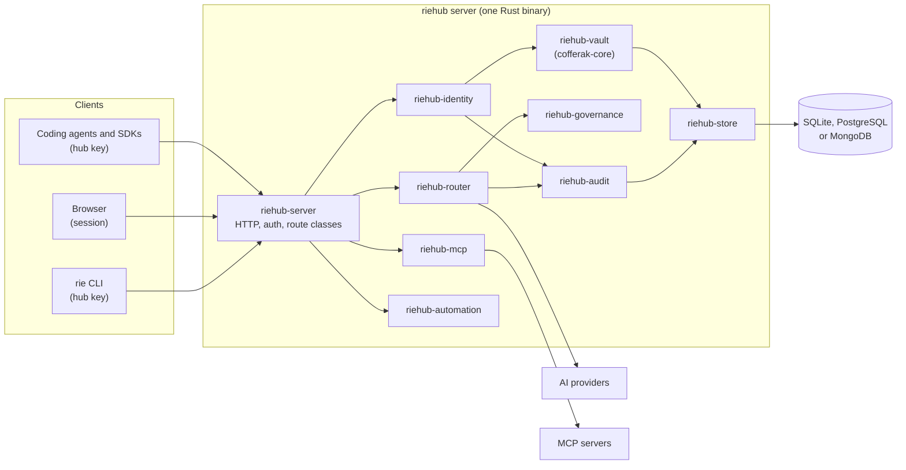
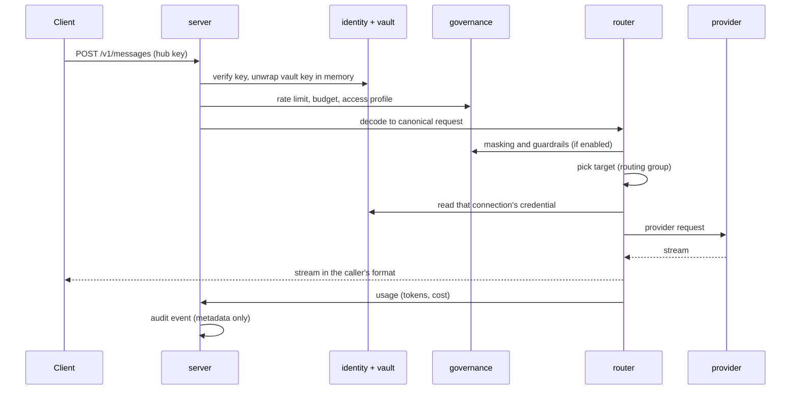

# riehub specification

riehub is a self-hosted server that gives every user of an organisation
one private entry point to AI: a router that speaks the OpenAI,
Anthropic and Gemini wire formats in front of any provider, plus that
user's own provider connections, MCP connectors, skills, chat sessions
and workflows. Many users share one instance. No user, and no
administrator, can read what another user sends through it.

This page and the linked subsystem pages define the product contract.
When code and spec disagree, bring them back into agreement with the
smallest clear change.

| Page | Covers |
|---|---|
| [Security and crypto](spec/security.md) | keys, the vault, encryption at rest, the audit log, process hardening |
| [Identity](spec/identity.md) | users, login, sessions, roles, hub keys, SSO |
| [Router](spec/router.md) | the request model, API surfaces, providers, connections, routing, usage |
| [Governance](spec/governance.md) | teams, budgets, rate limits, access profiles, masking, guardrails |
| [MCP](spec/mcp.md) | connectors, the MCP gateway, tool filtering, agent mode |
| [Automation](spec/automation.md) | skills, chat sessions, workflows, triggers, standing grants |
| [Storage](spec/storage.md) | the `Store` trait, records, backends, migrations |
| [API and configuration](spec/api.md) | HTTP conventions, route classes, config file, CLI |
| [Web UI](spec/web.md) | the design system and the pages |
| [Deployment](spec/deploy.md) | standalone, Docker, Kubernetes, TLS, tunnel, scaling |

## 1. Scope

riehub combines what two existing tools do, and removes their single
operator assumption:

- From a model manager for coding agents (magpie): any model for any
  agent, API format translation, provider accounts by API key or
  sign-in, routing groups with failover, privacy masking, usage and
  cost, a library of skills, instructions and MCP servers written into
  each agent's own config.
- From an enterprise AI gateway (Bifrost Enterprise): virtual keys,
  budgets and rate limits, teams and roles, an MCP gateway with tool
  filtering, guardrails, audit logs, SSO, metrics, clustering.

What riehub adds: every user is a tenant with their own vault, their
own connections and their own automation, and the server is built so
that operating it does not grant access to its users' data.

Platforms: Linux (Ubuntu 24.04 LTS or newer, or an equivalent
distribution, x86-64 and arm64) and macOS (arm64 and x86-64). Windows
is never supported, as a server or as a client.

## 2. Security invariants

These hold in every commit. Each has at least one test. A change that
breaks one is not mergeable. Details are in
[spec/security.md](spec/security.md).

| ID | Invariant |
|---|---|
| S1 | **Encrypted at rest under user-held keys.** Every credential and every piece of user content is stored only as AEAD ciphertext under a key that derives from a secret the user holds (password, session token, hub key, passkey or recovery key). Instance secrets are sealed by the host seal. |
| S2 | **No content outside the request path.** Prompts, completions, tool arguments, tool results, file contents and credentials never appear in logs, errors, metrics, traces, the audit log, crash output or temp files. |
| S3 | **No administrative read path.** No route, CLI command, export or role returns one user's content or secrets to anyone else. Roles grant management of metadata only. |
| S4 | **No impersonation.** Nothing lets one principal obtain a session, a hub key or an unlock slot for another user. An admin password reset does not open the vault. |
| S5 | **Tenant isolation in storage.** User-owned records are reachable only through a `UserScope` built from an authenticated request. A lookup with the wrong user returns "not found". |
| S6 | **Fail closed.** When authentication, authorization, a budget, a rate limit, masking, a guardrail or the audit write fails or errors, the request is refused. It is never passed through. |
| S7 | **Complete, tamper-evident audit.** Every state change and every routed request writes one audit event with allowlisted metadata fields. Events are hash chained. `riehub audit verify` detects removal or change. |
| S8 | **Hardened transport.** TLS 1.3 only where riehub terminates TLS. Cookies are `Secure`, `HttpOnly`, `SameSite`. State-changing browser requests need a CSRF token. The web UI runs under a strict Content Security Policy. |
| S9 | **Memory hygiene.** Keys and plaintext secrets are zeroized on drop. Core dumps and ptrace attach are disabled. Unlocked keys leave memory after an idle timeout. |
| S10 | **Supply chain.** No `unsafe` in riehub crates. Dependencies pass `cargo deny` and `npm audit`. Lockfiles are committed. Releases ship an SBOM and signed artifacts. |
| S11 | **Guarded egress.** Every outbound request to a URL that a user can influence passes the SSRF guard: no private, loopback, link-local or metadata addresses unless an admin allowlisted them, with the resolved address pinned for the connection. |
| S12 | **No telemetry.** riehub never calls home. The web UI loads nothing from a third-party origin. |

### 2.1 What an administrator can and cannot see

| Can see | Cannot see |
|---|---|
| Users: id, email, display name, status, roles, teams | Passwords, hub keys, session tokens, recovery keys |
| Usage metadata: request counts, token counts, cost, model id, provider kind, latency, status | Prompts, completions, tool calls, files |
| The audit log (metadata only) | Connection credentials, connection labels |
| Instance configuration, catalog entries, policies | Skills, workflows, chat sessions, masking matches |
| Health and metrics | Any user's vault |

An administrator can disable or delete a user. Deleting destroys the
vault keys, which makes the user's stored data unreadable.

### 2.2 Threat model

Protects against:

- Another user of the same instance, including an owner or admin acting
  through any riehub interface.
- Someone who reads the database, the data directory or a backup.
- Someone who reads the logs, the metrics, the traces or the audit log.
- A network attacker between the client and riehub, and between riehub
  and a provider.
- A stolen hub key or session token, limited to that credential's
  scope and lifetime, and visible in the audit log.
- A malicious provider, MCP server, skill or workflow trying to reach
  the internal network (SSRF) or another user's data.

Does not protect against:

- Someone with root on the host while a user's data is in use. Plain
  text exists in process memory during a request. S9 makes this
  harder, it does not make it impossible. This is the honest limit of
  S3: it is a guarantee about every riehub interface and about data at
  rest, not about a debugger attached to the running process.
- A modified riehub binary. Releases are signed so operators can check
  what they run.
- The upstream provider, which sees the prompts it is sent.
- A compromised user device, or a user who shares a hub key.
- Standing grants. A user who lets a workflow run unattended lets the
  host act for that workflow. See [automation](spec/automation.md).

## 3. Architecture

One process serves everything: the AI surfaces, the management API, the
MCP gateway and the web UI, which is embedded in the binary. State
lives only in the store. Nodes are stateless, so several can run behind
a load balancer (ADR 0012).

### 3.1 Crates and their boundaries

Dependencies point downward only. A crate never depends on one listed
below it.

| Crate | Owns | May depend on |
|---|---|---|
| `riehub-server` | the `riehub` binary, axum routes, middleware, wiring, embedded web assets | all crates below |
| `riehub-automation` | skills, chat sessions, workflow engine, triggers | router, mcp, governance, vault, audit, store, crypto, core |
| `riehub-plugins` | WebAssembly plugin host (version 0.9.0), plugged into the router pipeline by the server | router, egress, core |
| `riehub-mcp` | MCP client and gateway, connectors, tool filter | governance, oauth, egress, vault, audit, store, crypto, core |
| `riehub-router` | canonical request model, surface codecs, provider adapters, connections, routing, usage | governance, oauth, egress, vault, audit, store, crypto, core |
| `riehub-governance` | teams, budgets, rate limits, access profiles, masking, guardrails | identity, audit, store, crypto, core |
| `riehub-identity` | users, login, sessions, roles, hub keys, SSO | vault, audit, store, crypto, core |
| `riehub-oauth` | OAuth client engine: code with PKCE, device code, refresh | vault, egress, store, crypto, core |
| `riehub-vault` | per-user coffers and the instance coffer on `cofferak-core` | store, crypto, core |
| `riehub-egress` | the guarded HTTP client, the only way out (S11) | core |
| `riehub-audit` | typed events, hash chain, verification | store, crypto, core |
| `riehub-store` | the `Store` trait and its backends | core |
| `riehub-crypto` | AEAD, KDFs, hashing, random, constant-time compare | core |
| `riehub-core` | ids, errors, config types, `Secret<T>`, `Content`, clock | nothing in the workspace |
| `riehub-cli` | the `rie` binary for user machines | core only, talks to the server over HTTP |

### 3.2 Request path for an AI call

Any failed step before the provider call refuses the request (S6).

## 4. Delivery and versioning

Work in broad product phases. Build the planned feature set first, then
run the end-to-end suite, fix gaps and regressions, and make CI green
before calling a phase ready to ship.

| Version | Goal |
|---|---|
| `0.0.1` | Build the complete planned product feature set. This is a development build, not a production-ready release. |
| `0.0.2`–`0.0.100` | Publish useful testable previews quickly. Iterate on user feedback and defects with relevant CI checks. Do not wait for `0.0.100` to start testing. |
| `0.1.0` | Production-ready release with end-to-end coverage, security and dependency checks, deployment guidance, and green CI. |

Use Semantic Versioning after `0.1.0`. Until `1.0.0`, storage and API
may change between minor versions, and each change ships a migration.

## 5. Deliberately out of scope

| Not doing | Why |
|---|---|
| Windows, in any form | Maintainer decision (ADR 0002). |
| Hosting or running models | riehub routes to providers and local runtimes such as Ollama. It does not serve weights. |
| Reading user content for moderation or analytics on the server side for admins | Breaks S3. Guardrails run inside the user's own request and report only counts. |
| Pretending to be a vendor's official client to use a consumer subscription | Provider terms. Sign-in connections exist only where the provider allows third-party clients (ADR 0008). |
| Native code plugins | Plugins are WebAssembly with explicit capabilities (ADR 0014). |
| Its own key-wrapping scheme | The vault format and primitives come from cofferak (ADR 0005). |
| A gossip cluster | Nodes are stateless over a shared database (ADR 0012). |
