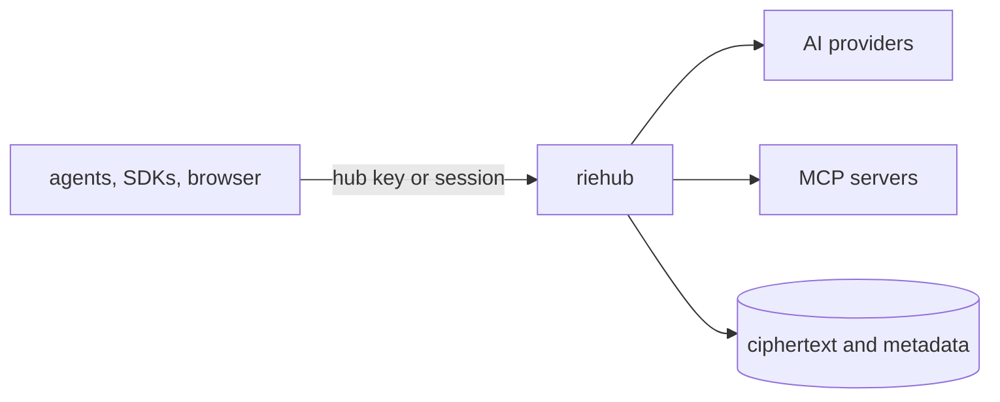

---
hide:
  - navigation
  - toc
---

**One private hub for every AI model, tool, skill and workflow.**

Multi-user, encrypted per user, one Rust binary. Linux and macOS.

[How it works](overview.md){ .md-button .md-button--primary }
[Roadmap](ROADMAP.md){ .md-button }

riehub is a self-hosted server that gives every person in a team one
private entry point to AI. It routes any agent or SDK to any model
provider, and it holds each user's own provider accounts, MCP
connectors, skills, chats and workflows. Many users share one instance.
Nobody, including the administrator, can read what another user sends
through it.

-   **One router, every format**

    OpenAI, Anthropic and Gemini wire formats in front of any provider,
    with routing groups, failover and budgets.
    [Router](spec/router.md)

-   **Each user holds their own keys**

    A per-user vault that only a secret the user presents can open.
    [Security and crypto](spec/security.md)

-   **Operators see metadata, never content**

    A hash-chained audit log without prompts or secrets.
    [Privacy model](adr/0004-privacy-model.md)

-   **Designed in the open**

    A specification, one decision record per design choice, and a
    progress table with proof.
    [Spec](SPEC.md) · [ADRs](adr/README.md) · [Progress](PROGRESS.md)

