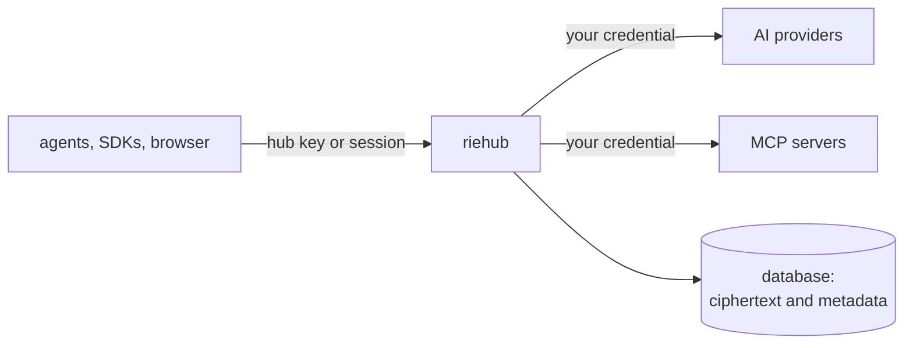

# Overview

## What riehub is

riehub is a self-hosted AI hub for a team. Each person gets one
address and one key that work with any coding agent or SDK, and behind
it their own provider accounts, their own tool connectors, their own
skills, chats and workflows. One instance serves many users and keeps
them apart, from each other and from whoever runs the server.

## Why it exists

Two kinds of tools already solve half of the problem each.

Model managers for coding agents make any agent use any model, switch
accounts when a quota runs out, and keep a library of skills and MCP
servers. They are built for one person on one machine.

Enterprise AI gateways add virtual keys, budgets, teams, an MCP
gateway, guardrails and audit logs. They are built for an operator who
can see everything that passes through.

riehub is both for a team, with one change in the foundation: the
operator cannot read the users' data. The decisions behind that are
[ADR 0004](adr/0004-privacy-model.md) and
[ADR 0005](adr/0005-user-vault-on-cofferak.md).

## How it works

1. **You hold the key.** Your password, your session and each hub key
   are the only things that can open your vault. The server stores
   nothing that opens it.
2. **A request unlocks only what it needs, for as long as it runs.**
   A hub key arrives, the server opens your vault in memory, reads the
   one credential the request needs, calls the provider, and streams
   the answer back in the format you asked in.
3. **Checks run first and fail closed.** Authentication, limits,
   budgets, masking and the audit write happen before the provider is
   called. If one of them fails, the request is refused.
4. **Only metadata is recorded.** The audit log and the usage tables
   hold who, when, which model, how many tokens, what it cost. Never
   the prompt or the answer.

The parts: a router with four API formats, a per-user vault, an MCP
gateway, a library and workflow engine, governance, and a web UI, all
in one Rust binary. The details are in the [specification](SPEC.md).

## What it does not do

- It does not run on Windows.
- It does not host models. It routes to providers and local runtimes.
- It does not give administrators a way to read prompts, for support,
  moderation or analytics.
- It does not protect a request from someone with root on the host
  while that request is in memory. The
  [threat model](SPEC.md#22-threat-model) says exactly where the line
  is.
- It does not sign in to a provider by posing as that provider's own
  app ([ADR 0008](adr/0008-connection-auth-types.md)).

## Where to go next

- [Specification](SPEC.md) for the exact contract and the invariants.
- [Roadmap](ROADMAP.md) for what each version adds.
- [Decisions](adr/README.md) for why it is built this way.
- [Getting started](getting-started.md) to build it.
