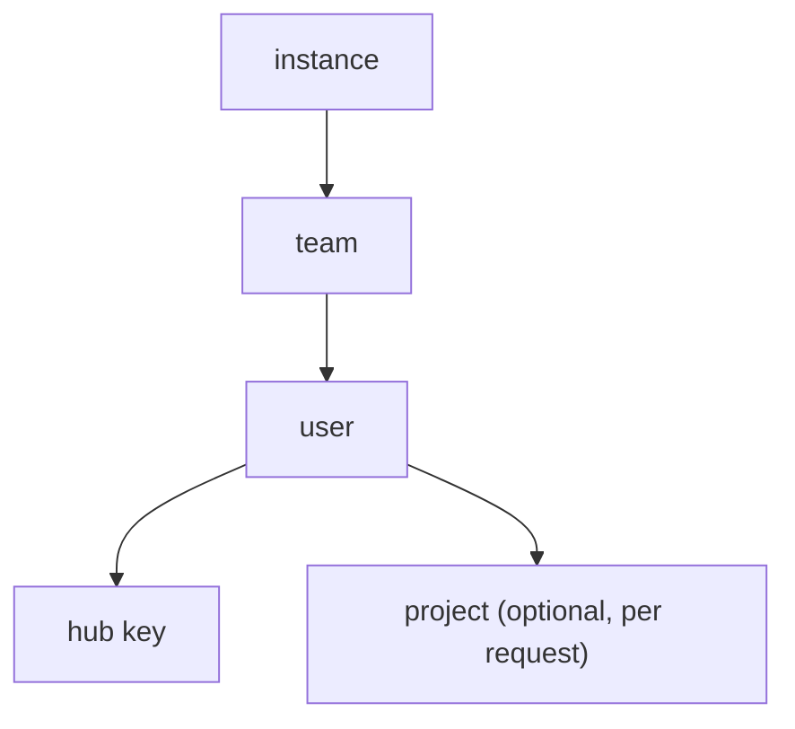

# Governance

Teams, limits, access profiles, masking and guardrails. Crate:
`riehub-governance`. Every check here fails closed (S6).

## 1. Hierarchy

- A **team** has members and optional managers. A user can be in
  several teams and has one primary team for accounting.
- A **project** is a label a caller selects with the header
  `x-riehub-project: <slug>` (version 0.7.0). It owns a budget and
  appears in reports.
- A **customer** is an external party a team serves. It groups hub
  keys for reporting and limits (version 0.7.0).

## 2. Rate limits and budgets

A **rate limit** is a token bucket: requests per minute and tokens per
minute. A **budget** is a cost ceiling per period (`day`, `week`,
`month`), in the instance currency.

Both can be set on the instance, a team, a user, a hub key, a project
and a customer. A request must pass every level that applies to it.
The lowest level that refuses decides the error:

| Refusal | Status | Body |
|---|---|---|
| rate limit | `429` with `Retry-After` | the surface's rate limit error |
| budget | `429` | the surface's quota error, naming the level |

Counters are in the store and updated atomically, so several nodes
share them. Token counts are charged after the response. A request is
admitted when the budget has any room left, and the overshoot of one
request is accepted. If the counter store errors, the request is
refused.

Users set limits on their own keys. Admins set limits on teams and
users. An admin sees how much of a budget is used, never what it was
used for beyond model and provider kind.

## 3. Access profiles

An access profile is a reusable policy an admin attaches to teams,
roles or users:

- which shared connections and which of their models are usable,
- which provider kinds users may connect on their own (or none),
- rate limits and budgets,
- which catalog connectors and virtual MCPs are available,
- baseline guardrail rules (section 5).

Profiles restrict. They never grant access to another user's data.
When several profiles apply, allowlists intersect and the lowest limit
wins.

## 4. Masking

Masking replaces sensitive values with placeholders before a request
leaves riehub, and puts them back in the reply. It is per user and off
by default.

- **Detectors**: built-in patterns for provider API keys, cloud keys,
  private key blocks, JWTs, bearer tokens, email addresses, phone
  numbers, payment card numbers (with Luhn check), IPv4 and IPv6
  addresses, plus the user's own regular expressions. Regular
  expressions are compiled with the `regex` crate (linear time) with a
  size limit.
- **Actions** per rule: `mask`, `warn` (count it, send unchanged),
  `block` (refuse the request).
- **Placeholders** look like `[[EMAIL_1]]`. The mapping lives in memory
  for the request only. In a streamed reply a placeholder that is split
  across chunks is buffered until it is whole, then restored. Tool call
  arguments are restored too.
- **Failure**: if detection or restoring errors, the request is refused
  with `503`. It is never sent unmasked.
- **Masking log**: per user, encrypted, holds the rule id, the kind,
  the length and the count. Never the value.

Admins can require baseline rules through an access profile. They see
only counts per rule and user.

## 5. Guardrails

Guardrails are rules evaluated on the request, and optionally on the
response, inside the user's own request:

| Rule type | Since |
|---|---|
| secrets and PII detectors (the masking detectors with action `block` or `warn`) | 0.6.0 |
| custom regular expression | 0.6.0 |
| maximum input size, allowed file types, allowed tool names | 0.6.0 |
| external guardrail service over HTTP (opt in, the user or admin names the endpoint, goes through the guarded client) | 0.9.0 |

A blocked request gets the surface's content filter error and an audit
event with the rule id.

## 6. Response cache (version 0.6.0)

Off by default, opt in per hub key. Exact match on the hash of the
canonical request. Entries are encrypted records owned by the user
with a time to live. There is no cache shared between users.
