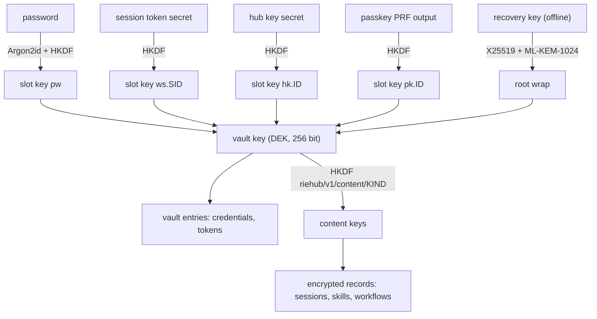

# Security and crypto

How the invariants S1 to S12 in the [specification](../SPEC.md) are
built. Decisions: ADR 0004 (privacy model), ADR 0005 (vault), ADR 0010
(audit).

## 1. Primitives

All of them come from `aws-lc-rs`, the `argon2` crate and
`cofferak-core`. riehub does not implement a primitive itself.

| Use | Primitive |
|---|---|
| Authenticated encryption | AES-256-GCM-SIV, 96-bit random nonce |
| Key derivation from keys | HKDF-SHA384 |
| Key derivation from passwords | Argon2id, 64 MiB, 3 passes, 1 lane, 16-byte salt, 32-byte output. Parameters are stored per user so they can be raised later |
| Hashing and MAC | SHA-384, HMAC-SHA384 |
| Recovery key | cofferak root keypair: X25519 with ML-KEM-1024 |
| Random | the operating system generator through `aws-lc-rs` |
| Comparison of tags and tokens | constant time |

`riehub-crypto` exposes exactly these functions:

```text
aead_seal(key: &Key32, aad: &[u8], plaintext: &[u8]) -> Vec<u8>      // 0x01 || nonce || ciphertext+tag
aead_open(key: &Key32, aad: &[u8], blob: &[u8]) -> Result<Zeroizing<Vec<u8>>>
hkdf(ikm: &[u8], info: &str) -> Key32
argon2id(password: &[u8], salt: &[u8; 16], params: Argon2Params) -> Key32
hmac(key: &Key32, data: &[u8]) -> [u8; 48]
sha384(data: &[u8]) -> [u8; 48]
random_bytes<const N: usize>() -> [u8; N]
ct_eq(a: &[u8], b: &[u8]) -> bool
```

`Key32` wraps 32 bytes, zeroizes on drop, and has no `Debug`, `Display`,
`Clone` or `Serialize`. Every `info` and `aad` string starts with
`riehub/v1/`. Changing a format bumps `v1`.

## 2. Types that keep secrets out of logs (S2)

`riehub-core` defines:

- `Secret<T>`: holds a credential. `Debug` and `Display` print
  `[secret]`. It does not implement `Serialize`. Reading the value needs
  an explicit `.expose()` call.
- `Content`: holds user content as bytes. Same rules, prints
  `[content]`.

Request bodies, prompts, completions, tool arguments and results,
credentials, tokens and passwords are carried only in these types from
the moment they are parsed. `scripts/rules-lint.sh` rejects print
macros and log calls with content-like field names. The privacy canary
test in section 8 proves the result.

## 3. The user vault (S1, S4)

Each user has one coffer, a `cofferak_core::format::VaultFile`. riehub
depends on `cofferak-core` from
`https://github.com/arkrwn/cofferak`, pinned by `rev` in the workspace
`Cargo.toml`. Bumping the pin is its own task with an ADR note.

### 3.1 Keys



- The **vault key** (DEK) is 32 random bytes made at signup. It is never
  stored unwrapped.
- An **unlock slot** is one entry in the coffer's `hosts` map:
  `wrap_dek_for_host(dek, slot_id, slot_key)`. Every credential a user
  can present is a slot. Slot ids: `pw` (password), `vp` (vault
  passphrase of an SSO user), `ws.<SID>` (web session), `hk.<ID>` (hub
  key), `pk.<ID>` (passkey), `sg.<ID>` (standing grant).
- The **recovery key** is the coffer's root private key,
  `RootPrivateKey::to_armored()`. It is shown once at signup and never
  stored. `root_wrap` lets it recover the vault key.

The server can open a vault only while it holds a secret that the user
just presented. Nothing stored on the server opens it, except a
standing grant the user created on purpose.

### 3.2 Slot keys

| Slot | Slot key |
|---|---|
| `pw`, `vp` | `m = argon2id(password, salt, params)`, then `hkdf(m, "riehub/v1/pw/slot")`. The login check uses `hkdf(m, "riehub/v1/pw/auth")`, stored as the verifier |
| `ws.<SID>`, `hk.<ID>` | token is `<prefix>_<ID>_<secret>`, secret is 32 random bytes in base64url. Slot key `hkdf(secret, "riehub/v1/token/slot")`, verifier `hkdf(secret, "riehub/v1/token/auth")` |
| `pk.<ID>` | `hkdf(prf_output, "riehub/v1/passkey/slot")` |
| `sg.<ID>` | 32 random bytes kept in the instance coffer |

Token prefixes: `rs` for sessions, `rh` for hub keys. The server stores
only the verifier. A token is checked by id lookup, then `ct_eq` on the
verifier.

### 3.3 Operations of `riehub-vault`

```text
create(user_id, first_slot) -> (Vault, RecoveryKey)       // new DEK, root wrap, first slot, sealed
unlock(vault, slot_id, slot_key) -> Unlocked              // verifies the MAC and the generation
recover(vault, recovery_key) -> Unlocked
add_slot(&mut vault, &unlocked, slot_id, slot_key)
remove_slot(&mut vault, &unlocked, slot_id)
set(&mut vault, &unlocked, path, value: Secret)           // value at most 1 MiB
get(&vault, &unlocked, scope: &Acl, path) -> Secret       // Acl uses cofferak acl::path_allowed
remove(&mut vault, &unlocked, path)
content_key(&unlocked, kind) -> Key32
save(store, scope, vault, expected_generation)            // compare-and-swap, retries on conflict by reload
```

Every write calls `VaultFile::seal(dek)`, which bumps the generation
and recomputes the MAC, then writes `to_bytes()` with compare-and-swap
on the generation. A vault write also writes the audit event
`vault.write` with the new generation. `unlock` refuses a vault whose
generation is lower than the newest audited one (rollback).

Vault entry paths:

| Path | Value |
|---|---|
| `conn/<con_id>/credential` | provider API key or other static credential |
| `conn/<con_id>/oauth` | OAuth token set |
| `mcp/<mcp_id>/credential` | MCP connector credential or token set |
| `wf/<wf_id>/webhook` | webhook signing secret |
| `tool/<name>/key` | key for a built-in tool such as web search |

A hub key carries an ACL: a list of path prefixes and a permission.
The request handler reads the vault through that ACL only.

### 3.4 Unlock cache (S9)

An unlocked vault key may stay in memory in a map keyed by token id and
vault generation. Entries are dropped after 10 minutes without use and
when the token is revoked or expires. The cache holds at most 10 000
entries. Every request still loads the token record from the store and
checks its status. The cache is never written to disk.

## 4. Encrypted records (S1)

User content that is not a credential is stored as a record
([storage](storage.md)) whose `data` field is
`aead_seal(content_key(kind), aad, plaintext)` with

```text
aad = "riehub/v1/rec" 0x00 kind 0x00 user_id 0x00 record_id 0x00 version
```

Moving a blob to another record, user or version makes it fail to open.
Anything a user typed as free text is content: names, labels,
descriptions, prompts, skill bodies, workflow files, transcripts. The
plain `meta` of a record holds only ids, enums, numbers and timestamps.

## 5. The instance coffer

Instance secrets live in a second coffer owned by the instance: the
audit MAC key, the cookie and CSRF key, OIDC client secrets, shared
provider credentials, standing grant keys. Its vault key is wrapped by
one host key. `instance.seal` in the config picks how the host key is
kept:

| Mode | Where | Backend |
|---|---|---|
| `systemd` | Linux standalone | `cofferak_core::seal::SystemdCredsSeal` |
| `keychain` | macOS | `cofferak_core::seal::KeychainSeal` |
| `file` | containers, Kubernetes | a 32-byte key file with mode 0600, mounted from a secret |

`riehub init` creates it and prints the instance recovery key once.
Shared provider credentials are used by the router for users an access
profile allows. No API returns them.

## 6. Audit log (S7)

Table `audit`, append only. One event:

| Field | Type |
|---|---|
| `seq` | u64, gapless |
| `ts` | UTC milliseconds |
| `actor` | `user:<id>`, `key:<id>`, `system` or `anonymous` |
| `action` | enum, for example `user.login`, `vault.write`, `key.create`, `ai.request`, `mcp.tool_call`, `policy.update` |
| `target` | optional typed id |
| `outcome` | `ok`, `denied`, `error` |
| `request_id` | id |
| `ip` | per `audit.ip`: `truncated` (default, /24 or /48), `full` or `off` |
| `attrs` | per-action struct of ids, enums, numbers and booleans only |
| `mac` | `hmac(audit_key, prev_mac || canonical_bytes(event))` |

Rules:

- `AuditEvent` is a Rust enum. No variant has a `String` or bytes field
  filled from a request. Model ids are checked against the catalog and
  stored as catalog ids, never as caller text.
- `ai.request` is written before the provider call. If the write
  fails, the request is refused (S6). Token counts and cost go to the
  usage tables afterwards, they are not part of the chain.
- Appends are serialized by the store so `seq` and `mac` form one
  chain. Writers may batch events for up to 10 ms.
- `riehub audit verify` walks the chain with the audit key and reports
  the first broken `seq`. `riehub audit head` prints the newest `seq`
  and `mac` so an operator can anchor it elsewhere.
- Retention deletes whole prefixes only, and writes a `audit.prune`
  event that carries the last removed `seq` and `mac`.

Readers: users read events where they are the actor or the target.
Holders of the `audit:read` permission read all events. Neither sees
content, because events hold none.

## 7. Process and transport hardening (S8, S9, S11)

- At start: core dump limit 0, and on Linux the process is marked
  non-dumpable (`nix` crate, no `unsafe` in riehub). Swap encryption
  and memory limits belong to the deployment and are set in the shipped
  systemd unit and Helm chart.
- TLS: `rustls` with the `aws-lc-rs` provider, TLS 1.3 only, for the
  listener and for every outbound connection.
- Cookies: `__Host-rs`, `Secure`, `HttpOnly`, `SameSite=Strict`,
  `Path=/`. The OIDC callback uses a separate short-lived `SameSite=Lax`
  state cookie.
- CSRF: state-changing `/api` requests from a browser session need the
  `X-CSRF-Token` header, which is `hmac(cookie_key, session_id)`.
- Headers on every response: `Strict-Transport-Security`,
  `X-Content-Type-Options: nosniff`, `Referrer-Policy: no-referrer`,
  `X-Frame-Options: DENY`, and for HTML
  `Content-Security-Policy: default-src 'self'; script-src 'self'; style-src 'self'; img-src 'self' data:; connect-src 'self'; frame-ancestors 'none'; base-uri 'none'; form-action 'self'`.
- Limits: request body 32 MiB by default, header 64 KiB, per-route
  timeouts, per-IP and per-account login throttling.
- The guarded HTTP client (S11) resolves the host, rejects loopback,
  private, link-local, CGNAT, multicast and cloud metadata ranges for
  IPv4 and IPv6 unless the host is in `egress.allow`, connects to the
  address it checked, and applies the same check to every redirect.
  It is the only way riehub code makes an outbound request.

## 8. The privacy canary test

One end-to-end test, extended by every task that adds a surface:

1. Start a server on a temp data directory with log level `trace`.
2. As user A, send the string `RIEHUB-CANARY-<random>` through every
   surface that exists: prompts, system prompts, tool arguments, tool
   results from a mock MCP server, skill bodies, workflow files, labels,
   and as the value of a connection credential.
3. Stop the server. Search for the canary in: every file under the data
   directory, the captured stdout and stderr, the audit export, the
   metrics output, the trace export, and every management API response
   fetched as an owner who is not user A.
4. The test fails on any hit.

It lives in `crates/riehub-server/tests/privacy_canary.rs` and runs in
`make test`.
